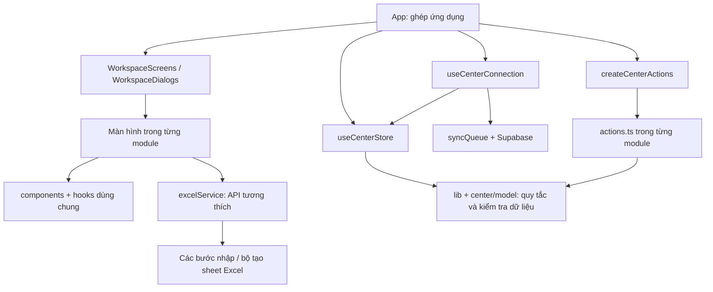

# Cấu trúc module BeeZone

`App.tsx` chỉ ghép giao diện và các bộ điều khiển. Màn hình, thao tác nghiệp vụ, lưu dữ liệu và dịch vụ Excel có trách nhiệm riêng. Việc tách này giúp khoanh vùng thay đổi và kiểm thử; không bảo đảm mọi cập nhật sau này đều không phát sinh lỗi.

## Các phần chính

| Thư mục | Trách nhiệm |
| --- | --- |
| `src/app` | Khung ứng dụng, ghép màn hình/dialog, tìm kiếm nhanh, điều hướng và PWA |
| `src/modules/center` | Trạng thái trung tâm, chuẩn hóa liên kết, đăng nhập/tải dữ liệu và hàng đợi đồng bộ |
| `src/modules/dashboard` | Tổng quan, việc cần làm và bảng chi tiết |
| `src/modules/admissions` | Tuyển sinh và xác nhận ghi danh |
| `src/modules/students` | Hồ sơ học viên, bảo lưu/nghỉ/học lại, lịch sử đăng ký |
| `src/modules/programs`, `classes` | Chương trình, đợt học và sĩ số |
| `src/modules/teachers`, `rooms` | Giáo viên, phân công và phòng học |
| `src/modules/timetable` | Lịch tuần, lịch giáo viên, nghỉ/học bù theo ngày |
| `src/modules/attendance`, `grades` | Điểm danh, điểm số và phiếu kết quả |
| `src/modules/tuition` | Phiếu thu, đóng nhiều đợt, phí theo buổi, công nợ và bản in |
| `src/modules/reports` | Báo cáo quản trị |
| `src/modules/auth` | Giao diện đăng nhập, tài khoản và phân quyền |
| `src/modules/system` | Sao lưu, nhập/xuất, cài đặt, kiểm tra dữ liệu và nhật ký |
| `src/components`, `hooks`, `context` | Thành phần dùng chung: bảng cuộn, dialog, thống kê, bố cục, ngôn ngữ |
| `src/lib` | Quy tắc thuần: ngày, lịch, học phí, buổi học, quyền và kiểm tra payload |
| `src/services/excel` | Đọc ô, từng bước nhập, công thức và từng sheet xuất |
| `api`, `server`, `supabase/migrations` | API có xác thực và quy tắc dữ liệu trên máy chủ |

API quản trị đi qua `server/admin.ts` để dùng chung kiểm tra yêu cầu, xác thực, quyền và quota. `server/request.ts` kiểm tra header/payload, `server/rateLimit.ts` giữ bộ đếm burst có giới hạn bộ nhớ. Quota dùng chung giữa máy chủ và chống ghi dữ liệu trực tiếp nằm trong migration `009_request_quotas.sql`; chỉ triển khai API cần RPC sau khi migration đã được thử và áp dụng. Cấu hình WAF nằm ở Vercel, định nghĩa quy tắc tại `ops/admin-api-rate-limit.json`; chỉ thêm tệp này vào Git không tự bật firewall.

Máy chủ Vite phát triển nạp API qua `server.ssrLoadModule` khi có yêu cầu. Không import handler/helper API trực tiếp vào `vite.config.ts`: các thay đổi API có thể gây nhiều lần khởi động lại và tranh cổng, để HTML trả 200 nhưng JavaScript trả 504. Khi kiểm tra localhost, kiểm tra cả `/@vite/client`, module JavaScript và API ngoài HTML. Production tiếp tục chạy handler Vercel riêng.

## Hướng phụ thuộc

Các mũi tên thể hiện phụ thuộc sử dụng; tham chiếu type được TypeScript loại khỏi mã chạy. `actions.ts` khai báo `Context` bằng `Pick<CenterStore, ...>` để chỉ nhận những phần mình cần. Bộ ghép `createCenterActions` kết nối các nhóm thao tác, còn màn hình nhận dữ liệu và callback qua props. Không import màn hình hoặc `App` vào nghiệp vụ.

## Những quy tắc cần giữ khi cập nhật

- `useCenterStore` sở hữu dữ liệu dùng chung và lưu bản xem thử. Không tạo một bản học viên/phiếu thu thứ hai trong module khác. State riêng của form, bộ lọc và dialog có thể nằm trong màn hình.
- Danh sách menu nằm ở `app/navigation.ts`. Sidebar và URL cùng dùng `canAccessTab`; quyền hiển thị không thay thế quyền API/SQL.
- Danh mục quyền và chuẩn hóa boolean nằm ở `lib/permissions.ts`, dùng chung khi đọc profile và ghi qua API quản trị. Quyền `academic.programs`, `academic.classes` (gồm lịch học), `academic.rooms` là các quyền quản lý được cấp riêng; hồ sơ cũ thiếu khóa không được tự nâng quyền. Migration 011 kiểm tra cùng các quyền này ở database và bảo vệ liên kết/lịch sử khi xóa. Refresh khi quay lại tab chỉ kiểm tra profile, giữ nguyên payload và revision CAS đang sửa.
- Cấp bậc tài khoản dùng bốn giá trị hiển thị: `owner` (Chủ trung tâm), `admin` (Hành chính), `trainer` (Đào tạo), `teacher` (Giáo viên). `lib/accountRoles.ts` là nguồn nhãn/hướng dẫn/chuẩn hóa dùng chung, còn `createRolePermissions` tạo quyền đề xuất có thể chỉnh trước khi lưu. Giá trị `staff` cũ chỉ được đọc tương thích và chuyển thành `teacher`, không tự nâng quyền chi tiết. `normalizeRolePermissions` là trần quyền theo cấp bậc: Giáo viên chỉ có Tổng quan, Giao việc, Học viên theo lớp, Điểm danh, Lịch của chính mình và Điểm số; hồ sơ học viên không hiển thị thông tin cá nhân/học phí và các quyền quản lý khác không thể mở lại bằng cờ quyền cũ. Đào tạo có phạm vi lớp toàn trung tâm cho nghiệp vụ điểm số khi được cấp `grade.edit`; không phụ thuộc danh sách lớp giáo viên. Chủ trung tâm và Hành chính được dùng API quản lý tài khoản; Hành chính không được cấp/sửa/khóa/xóa Chủ trung tâm hoặc tự sửa chính mình, và các giới hạn này phải được kiểm tra lại ở máy chủ. Nhật ký quản trị vẫn chỉ dành cho Chủ trung tâm. Migration 018–019 mở rộng enum, đổi hồ sơ cũ và giữ nguyên permissions/lớp phụ trách/lịch sử; migration 026 áp trần ghi của Giáo viên tại database. Không tự chạy migration production.
- Bộ lọc có tên chương trình/lớp dài dùng `components/ResponsiveSelect.tsx`. Component nhận giá trị và callback từ module, không giữ bản dữ liệu nghiệp vụ riêng. Dropdown dùng Radix Select để quản lý focus, bàn phím và vị trí; CSS giới hạn chiều rộng/chiều cao theo viewport, cho tên lựa chọn xuống dòng. Trong hộp thoại, portal dùng `DialogPortalContext` của `DialogFrame` để nằm cùng vùng focus và lớp hiển thị; không đưa popup ra `body` ngoài hộp thoại. `useOverlay` tôn trọng sự kiện đã được popup xử lý để Escape đóng danh sách trước khi đóng hộp thoại. Khi thêm bộ chọn tương tự, tái sử dụng component và kiểm tra cả trạng thái mở.
- Sidebar chia vùng menu cuộn và chân menu cố định bằng flex. Chân menu không phủ lên mục điều hướng; kiểm tra cuộn tới mục cuối bằng chuột, cảm ứng và bàn phím khi thay đổi chiều cao hoặc thêm mục.
- Dữ liệu tải từ Supabase và dữ liệu nhập phải đi qua `parseCenterData` trước khi thay trạng thái. `normalizeCenterData` dùng chung cho tải dữ liệu, nhập Excel và khôi phục JSON. Hàm này sửa liên kết phát sinh và trạng thái phí, không xóa lịch sử giao dịch.
- `applyData` thay toàn bộ bộ dữ liệu đã kiểm tra; dùng thao tác từng module cho thay đổi một hồ sơ. `clearData` chỉ xóa dữ liệu trong bộ nhớ khi kết thúc phiên. Không xóa dữ liệu trình duyệt khi đổi phiên bản schema.
- `student.classId` là lớp chính, `student.additionalClassIds` (tùy chọn) là các lớp học thêm; hồ sơ cũ thiếu mảng này vẫn đọc được. Dùng `lib/studentClasses.ts` để đọc tư cách thành viên, không so sánh riêng lớp chính khi tính sĩ số, điểm danh, điểm số hoặc học phí theo lớp. `class.teacherId` là phân công gốc; `class.studentIds`, `teacher.assignedClassIds` và `student.feeStatus` được suy ra lại. Lịch sử đăng ký đóng/mở riêng từng cặp học viên–lớp, không đóng lớp khác khi bỏ một lớp. Migration 012 kiểm tra mảng bổ sung, tham chiếu, roster và chặn client cũ làm mất mảng đã lưu.
- Phiếu học phí theo buổi tham chiếu buổi điểm danh và đơn giá chụp tại thời điểm học. Buổi đã lập phiếu phải giữ lịch sử; buổi chưa lập phiếu được tính vào công nợ đọc, không lưu phiếu ảo vào cơ sở dữ liệu.
- Refresh token chỉ cập nhật phiên/quyền, không tải lại dữ liệu đang sửa. Giữ việc trì hoãn truy vấn khỏi callback khóa của Supabase Auth, hủy kết quả phiên cũ, debounce và kiểm tra `updated_at` trước khi lưu. Xung đột phải báo người dùng, không tự ghi đè.
- Khi kiểm tra profile lỗi mạng, tạm dừng đồng bộ và giữ dữ liệu đang sửa cùng revision CAS. Lần Thử lại của cùng tài khoản chỉ xác minh lại quyền rồi nối lại hàng đợi; không tải payload máy chủ đè lên bản đang sửa. Profile bị khóa hoặc đổi tài khoản vẫn phải qua kiểm tra quyền/tải dữ liệu của phiên mới. Phản hồi `getSession` ban đầu không được ghi đè trạng thái từ sự kiện Auth mới hơn, kể cả khi phản hồi đó là lỗi.
- `services/excelService.ts` là API công khai tương thích. Xuất Excel ghép sheet theo thứ tự để giữ liên kết; `exportContext` chuẩn bị chỉ mục một lần. Nhập xử lý học vụ → học viên → tài chính/điểm danh → điểm/lịch. Không cập nhật state ứng dụng khi một bước nhập còn lỗi.
- Schema, khóa localStorage, URL `?tab=` và định dạng JSON/Excel được giữ tương thích trong lần refactor này. Không có migration hay thay đổi dữ liệu production trong lần tách module.

## Thêm một chức năng

Thông báo nghiệp vụ dùng `lib/dialogs.ts` (`showAlert`, `askConfirmation`), hiển thị qua `NotificationDialogs` tại điểm ghép ứng dụng. Không gọi `window.alert`/`window.confirm` trong module; xác nhận là bất đồng bộ và phải chờ kết quả trước khi thay dữ liệu. `DialogFrame` portal ra `document.body` để tránh vùng cha có transform làm lệch vị trí; popup chọn bên trong vẫn portal vào chính dialog qua `DialogPortalContext` để giữ focus và thứ tự lớp. Hộp thoại căn theo visual viewport khi bàn phím mở.

Form chọn nhiều ngày dạy dùng `handleSaveSlots`: kiểm tra cả nhóm rồi cập nhật lịch và tóm tắt lớp một lần. Không gọi nhiều lệnh ghi danh sách từ cùng một snapshot trong vòng lặp, vì ca ghi sau có thể thay mất ca ghi trước.

Quyền thêm/sửa/xóa đào tạo dùng `academicPermission`/`canManageAcademic` với action cụ thể, tương ứng migration 013. Các khóa cũ chỉ làm mặc định khi khóa mới chưa tồn tại; giá trị `false` mới phải thu hồi được quyền cũ. `teacher.add` tách riêng khỏi `teacher.edit`. `handleSaveTeacher` ghi phân công qua `class.teacherId`, sau đó store suy ra danh sách lớp phụ trách. `ConfirmedForm` xác nhận trước khi ghi form đang sửa; danh sách nhiều lớp dùng checkbox, giữ dữ liệu nháp khi hủy.

Không tự xóa điểm danh theo ngày cố định, ID hoặc trạng thái vắng/đi muộn khi cập nhật học viên. Buổi đã có entries là lịch sử học tập; chỉ chủ trung tâm đang hoạt động được xóa buổi trống chưa liên kết phiếu thu. Dữ liệu sai trong buổi có lịch sử được chỉnh sửa theo các kiểm tra học phí hiện có.

Nhận xét lực học trong một bản điểm hiện có được sửa trực tiếp từ hồ sơ học viên bởi tài khoản có quyền xem học viên. Ngoại lệ này chỉ áp dụng cho trường `Grade.comment`, tối đa 2000 ký tự; thêm/xóa bản điểm hoặc đổi điểm thành phần vẫn cần `grade.edit` và phạm vi lớp. Hành chính/Đào tạo có phạm vi nghiệp vụ toàn trung tâm, Giáo viên giữ phạm vi lớp được phân công. Migration 020 thực thi cùng quy tắc tại database và không được tự áp dụng vào production trong công việc refactor.

1. Tạo hoặc mở thư mục module phù hợp. Đặt giao diện trong file `.tsx`, quy tắc không phụ thuộc giao diện trong `lib`/model và thao tác thay dữ liệu trong `actions.ts`.
2. Khai báo type và `Context` rõ ràng; tái sử dụng dialog/bảng cuộn/thẻ thống kê dùng chung. Nạp màn hình nặng bằng `lazy` để giữ kích thước khởi động.
3. Nếu thêm trang: khai báo ID/nhãn/icon tại `navigation.ts`, quyền tại `canAccessTab` và case tại `WorkspaceScreens`. Nếu thêm thao tác: ghép trong `createCenterActions` và nối callback của màn hình.
4. Nếu thêm trường dữ liệu: cập nhật type, `parseCenterData`, chuẩn hóa/lưu/tải, sao lưu JSON, Excel khi cần và migration kiểm tra trên máy chủ. Trường cũ thiếu phải có giá trị mặc định hợp lý.
5. Thêm kiểm thử cho quy tắc mới và ảnh hưởng tới các phần liên quan. Chạy `npm run check` trước khi commit. Thử giao diện thực tế nếu thay bố cục; jsdom không đo kích thước màn hình thật.

## Kiểm tra tự động

`npm run check` kiểm tra TypeScript, toàn bộ test và bản production. `tests/architecture.test.ts` quét `src`, `api`, `server` theo cách TypeScript giải quyết đường dẫn trong `tsconfig.json`. Bộ kiểm tra theo cả import tương đối, alias, re-export, lazy import và `require` có tên module dạng literal; bỏ qua tham chiếu chỉ dùng cho type. Nó chặn vòng phụ thuộc và phụ thuộc ngược từ nghiệp vụ/dịch vụ vào giao diện, kể cả qua helper trung gian hoặc import React trong tệp `.ts`.

Kiểm tra ranh giới máy chủ chặn API/server dùng workflow ghi state, UI hoặc Supabase client lưu phiên trình duyệt. Mã trình duyệt không được import handler `api`/`server` hoặc module dùng tiền tố `node:`. Đặt quy tắc có thể dùng ở hai phía trong `lib`/model; API vẫn phải tự xác thực và kiểm tra quyền. Các import có đường dẫn tính toán hoặc mã sinh tự động cần được rà riêng.

`tests/module-actions.test.tsx` kiểm tra kết nối state với nghiệp vụ, lịch sử tài chính, quyền và lưu/khôi phục. Các test đăng nhập, đồng bộ, Excel, database và giao diện tiếp tục kiểm tra hành vi cũ. Các ca giả lập phụ thuộc sai trong test kiến trúc chứng minh bộ kiểm tra phát hiện được lỗi, thay vì chỉ kiểm tra dự án hiện tại đang qua.

GitHub Actions ở `.github/workflows/check.yml` chạy cùng lệnh khi push `main` hoặc mở PR. Có thể đặt job `check` làm điều kiện bắt buộc trong quy tắc nhánh GitHub; lần refactor này không thay đổi quy tắc nhánh của tài khoản.

Một số màn hình nhập liệu vẫn lớn vì chứa nhiều trường và luồng xử lý. Chúng đã nằm trong module riêng; hồ sơ xem chi tiết, bản in phiếu thu, phí buổi và lịch điều chỉnh có component riêng. Khi bổ sung một luồng lớn, tách component/hook theo trách nhiệm và giữ kiểm thử hành vi thay vì chia file chỉ để giảm số dòng.

Thông báo và nhận xét gửi phụ huynh nằm trong `modules/attendance/ShareReviewDialog.tsx`/`ParentContactDialog.tsx`; mẫu tin, số điện thoại và quy tắc giữ lịch sử nằm trong `parentContact.ts`, thao tác ghi nhận ở `actions.ts`. Tài khoản có quyền xem lớp được soạn tin, mở Zalo/SMS hoặc sao chép ngay từ dữ liệu đang nhập mà không cần lưu điểm danh trước. Chỉ việc ghi lịch sử liên hệ vào `AttendanceStudentEntry.note` mới yêu cầu buổi học đã lưu; lần liên hệ có thời gian theo giờ Việt Nam, kênh và người ghi nhận, tương thích JSON/Excel cũ và dùng quyền sửa điểm danh theo lớp trên SQL hiện có. Đây là ghi nhận thủ công, không phải xác nhận giao tin của Zalo. Sửa nhận xét, đổi trạng thái điểm danh và lưu lại phải giữ các dòng lịch sử này.

Phân hệ Giao việc lấy cấp bậc đang hoạt động trực tiếp từ `profiles` qua `bz_work_role`; không dùng bản chiếu `bz_work_people` có thể cũ để quyết định quyền đọc. Chủ trung tâm và Hành chính đọc toàn bộ công việc, ghi chú, lý do và bàn giao của cả ba nhóm Hành chính/Đào tạo/Giáo viên. Đào tạo chỉ quản lý nhóm Đào tạo và Giáo viên; Giáo viên chỉ đọc việc được giao hoặc đang chờ chính mình nhận bàn giao. Đồng bộ đa thiết bị dựa trên thay đổi PostgreSQL có RLS, không phát nguyên snapshot qua kênh broadcast. Client đồng bộ danh bạ trước khi tải các bảng công việc để lần tải đầu sau khi đổi cấp bậc đã có phạm vi đúng. Migration 021, 023 và 024 giữ các quy tắc này ở database và không tự chạy trên production.

Sao lưu JSON schema 2 dùng `createBackupArchive`/`verifyBackupArchive` trong `lib/centerData.ts`, kèm SHA-256 cho toàn bộ `center_data` và snapshot các bảng `bz_work_*`; schema 1 cũ vẫn đọc được. Trước khi khôi phục, client phải kiểm tra định dạng, liên kết, mã toàn vẹn và hiển thị số nhóm/bản ghi nhận diện. Bản có Giao việc được khôi phục nguyên tử bởi RPC owner-only ở migration 024; không sao lưu hay ghi đè tài khoản Auth, mật khẩu, phiên hoặc secret. Migration này cũng đồng bộ quyền đọc nội dung con của ba nhóm Giao việc sau migration 023. Vercel gọi `/api/cron/daily-backup` lúc `19:00 UTC` (khoảng 02:00 Việt Nam), xác thực bằng `CRON_SECRET`, tạo tệp đầy đủ và gửi tới `settings.adminReportEmail` qua Resend với idempotency theo ngày. Cần cấu hình `RESEND_API_KEY` và `BACKUP_FROM_EMAIL`; không tự áp dụng migration hay secret production từ mã nguồn.

PWA dùng network-first và buộc navigation không dùng HTTP cache. SPA fallback trên Vercel không được bắt `/assets` hoặc `/api`, để tệp chunk đã bị gỡ trả lỗi thật thay vì HTML có mã 200. Khi gặp `UI-MODULE`, nút khắc phục chỉ xóa cache giao diện/service worker BeeZone rồi tải lại; không xóa dữ liệu nghiệp vụ trong Supabase.

Đăng ký giáo viên nghỉ một buổi dùng `scheduleChanges.kind = 'teacher_off'`, tham chiếu ca học định kỳ qua `sourceSlotId` và giáo viên thay thế tùy chọn qua `substituteTeacherId`. Khi chưa xếp giáo viên thay thế, buổi đó chưa được tính là buổi đang dạy trong lịch thực tế/điểm danh. Khi đã xếp, `lessonsOn` gán ca cho giáo viên thay thế; thời khóa biểu và lịch giáo viên vẫn hiển thị giáo viên chính đang nghỉ. Giáo viên thay thế chỉ được mở, điểm danh, cập nhật nội dung buổi học và liên hệ phụ huynh cho đúng `classId` + `date`; lịch sử các ngày khác không hiển thị và quyền này không mở điểm số/lớp khác. Migration 025 kiểm tra lại cùng phạm vi khi ghi `attendanceSessions`, dùng lịch đã tồn tại trước thao tác để không thể tự cấp quyền trong cùng một lần ghi. Không sửa giáo viên hoặc giờ ca gốc khi còn điều chỉnh liên quan. Công việc giáo viên nghỉ tự chuyển vào nhóm Giáo viên; nút Bàn giao phải chọn người nhận, tạo bản ghi chờ xác nhận và chỉ đổi người phụ trách sau khi người nhận xác nhận. Chủ trung tâm/Hành chính thấy toàn bộ, Đào tạo thấy nhóm Đào tạo/Giáo viên. Migration 015 và 025 phải được áp dụng theo thứ tự trước khi sử dụng chức năng ở production.

`class.teacherId` là nguồn phân công giáo viên chính của lịch tuần. `linkedTimetableSlots` chỉ đưa vào Thời khóa biểu, Lịch giáo viên, Điểm danh và Giao việc các ca có `TimetableSlot.teacherId` khớp lớp; ca lệch cũ vẫn còn trong sao lưu để không xóa lịch sử âm thầm. Khi đổi giáo viên từ thời khóa biểu, toàn bộ ca tuần cùng lớp và phân công lớp được cập nhật cùng nhau; khi bỏ lớp khỏi giáo viên, ca tuần được xóa và tóm tắt `days`/`scheduleTime` được làm rỗng. Không được bỏ phân công nếu còn `scheduleChanges` tham chiếu ca gốc. Migration 027 kiểm tra liên kết này ở database đối với dữ liệu được thay đổi.

Bảng điểm dùng bốn học kỳ `GKI`, `CKI`, `GKII`, `CKII`; mỗi học viên có tối đa một bản ghi cho mỗi tổ hợp học viên + lớp + học kỳ. Điểm trung bình học kỳ lấy Nghe, Nói, Đọc & Viết và các cột UNIT/bài/điểm đang hoạt động đã có điểm; `reading`/`writing` cùng các trường điểm cũ vẫn được giữ để đọc sao lưu và Excel cũ. Cột UNIT mặc định lần lượt là 1–3, 4–6, 7–9, 10–12. Cột tùy chỉnh bắt buộc theo chương trình và học kỳ, phân loại `unit` hoặc `assessment`; có thể thêm hai loại trong một thao tác. Xóa cột là lưu trữ mềm bằng `archivedAt`: cột ngừng hiển thị và ngừng tham gia ĐTB nhưng `unitScores` lịch sử không bị xóa. Mỗi thay đổi cấu trúc phải tính lại ĐTB của toàn bộ bản điểm trong cùng lần cập nhật state. Ô điểm giữ bản nháp để nhập tay số thập phân, chỉ lưu khi Enter hoặc rời ô. Tổng kết năm là dữ liệu suy ra từ ĐTB của bốn kỳ, hiển thị rõ kết quả tạm tính khi chưa đủ 4/4 kỳ và không tạo bản ghi trùng. Nhận xét dùng bản nháp có Lưu/Hủy/Xóa, tự tăng chiều cao và có thể mở rộng/thu gọn. Người có `grade.edit` nhập điểm trong phạm vi lớp được phép; Chủ trung tâm hoặc tài khoản Hành chính/Đào tạo có `grade.edit` được đổi riêng cấu trúc cột dùng chung, còn các trường `settings` khác vẫn chỉ Chủ trung tâm được sửa. Migration 028 kiểm tra học kỳ và điểm; migration 029 kiểm tra loại cột, phạm vi chương trình, lưu trữ mềm và trùng cột; migration 030 khớp quyền đổi `gradeColumns` tại database. Không tự chạy migration production.

## Chọn nơi sửa và kiểm tra phần liên quan

Privacy của tài khoản nằm trong profile máy chủ (`is_private`, migration 010), không lấy từ metadata người dùng, email hardcode hay localStorage. `profileToAccount` chỉ ánh xạ cờ này sang hiển thị; nó không đổi quyền. API tài khoản vẫn qua `adminApi`/quota và bỏ danh tính tài khoản riêng khỏi danh sách, trả các ID chỉ để lọc phiên cục bộ đã lưu trước đây. Profile cũ thiếu cờ mặc định hiển thị như cũ. Script `create-private-owner-setup.mjs` chỉ sinh SQL riêng vào `.vercel` từ stdin; không commit email hoặc tự chạy SQL production. Ghi nhận quyền qua allowlist có audit; không xóa lịch sử để ẩn tài khoản.

Migration 014 bổ sung `account_visibility_rules` để một tài khoản (kể cả nhân viên) chỉ xuất hiện trong quản lý tài khoản đối với một chủ trung tâm được chỉ định. Cấu hình chỉ do quản trị database ghi, không cấp thêm vai trò/quyền hay kích hoạt người dùng. `server/accountVisibility.ts` áp dụng cùng quy tắc cho danh sách, các thao tác quản trị và bản hiển thị nhật ký. Cờ `is_private` cũ vẫn ẩn với mọi người; lỗi đọc quy tắc phải đóng truy cập, chỉ database chưa có bảng mới mới giữ hành vi cũ. `scripts/create-account-visibility-setup.mjs` nhận email qua stdin, sinh migration và cấu hình riêng trong `.vercel`, không đưa email thật vào Git.

`useOverlay` quản lý cả focus và thứ tự z-index của các portal đang mở. Hộp xác nhận phải nằm trên cửa sổ sửa quyền, kể cả khi cửa sổ cha dùng z-60. Lỗi cập nhật quyền hiện trong chính cửa sổ sửa; thông báo thành công hiện ngay sau khi API xác nhận, trước khi tải lại danh sách.

Nhật ký production dùng bản hiển thị do `/api/admin/audit-logs` tạo từ profile máy chủ qua `lib/auditPrivacy.ts`: bỏ toàn bộ dòng do tài khoản riêng thực hiện, nhắm vào tài khoản riêng hoặc chứa ID/email/tên nhận diện của tài khoản riêng. Áp dụng cho cả nhật ký thao tác và nhật ký tài khoản, trước khi trả về trình duyệt; không chỉ thay tên bằng nhãn hệ thống. Danh tính được đối chiếu với profile có `is_private = true`, không hardcode email; nhãn chung “Quản trị hệ thống” không tự xác định một tài khoản riêng. `useAccountAudit` chỉ hiển thị bản này, chặn kết quả phiên cũ và không dùng nhật ký thô làm dự phòng khi API lỗi. Nhật ký gốc trong database, state đồng bộ và sao lưu vẫn được giữ nguyên; bản hiển thị không được ghi ngược vào dữ liệu trung tâm. Nút Làm mới tải lại nhật ký đã lưu trên máy chủ.

Địa chỉ chính là `https://beezone-english.vercel.app`. Hai alias theo team được chuyển hướng ở trang gốc bằng `vercel.json`; callback có mã OAuth được ứng dụng xử lý riêng qua `lib/appUrl.ts` trước khi tạo Supabase client. Mã PKCE/phiên trình duyệt thuộc một origin, nên callback cũ trên alias được bỏ mã rồi chuyển sang trang đăng nhập của domain chính, không chuyển token hoặc verifier giữa các domain. Quy tắc domain chính không chuyển hướng localhost và deployment xem thử. Sau khi SDK trả về phiên hợp lệ, dọn tham số OAuth còn sót mà giữ `?tab=`, tham số giao diện và anchor thường.

Khi phát triển local, có thể cấu hình `VITE_LOCAL_AUTH_ORIGIN` trong `.env.local` nếu Supabase chưa chấp nhận hostname đang dùng. `AuthScreen` chỉ chuyển màn hình chưa đăng nhập sang HTTP loopback cùng cổng trước khi bắt đầu Google OAuth; quyết định URL nằm trong `lib/appUrl.ts`. Giữ đường dẫn/tham số giao diện, bỏ callback cũ và không chuyển phiên/verifier. Không tự điều hướng workspace đang đăng nhập; production bỏ qua biến này. Xem cách cấu hình tại `SUPABASE_SETUP.md`.

| Thay đổi | Nơi sửa chính | Phần liên quan cần kiểm tra |
| --- | --- | --- |
| Tiếp nhận, ghi danh, chuyển lớp, bảo lưu | `modules/admissions`, `modules/students/actions.ts`, `lib/operations` | Roster lớp, lịch sử đăng ký, điểm/phiếu thu lớp cũ; `module-actions`, `operations`, `data` |
| Lớp, giáo viên, phòng và lịch | Các module tương ứng, `lib/schedule`, `lib/operations`, `center/model` | Trùng giáo viên/phòng/giờ, phân công, sĩ số, lịch nghỉ/học bù; `operations`, `module-actions`, `database` |
| Thu tiền và phí theo buổi | `modules/tuition`, `modules/attendance`, `lib/tuition`, `lib/sessionBilling` | Có mặt/đi trễ, buổi vắng, đơn giá đã chốt, thu nhiều đợt, công nợ, báo cáo/Excel; các test `session-billing`, `excel`, `module-actions` |
| Điểm số | `modules/grades`, validation payload, sheet/nhập điểm Excel | Điểm theo học viên–lớp, lịch sử khi chuyển lớp, quyền nhập điểm; `ui`, `excel`, `database`, `module-actions` |
| Trường dữ liệu hoặc định dạng nhập/sao lưu | `types`, `lib/centerData`, `center/model`, `services/excel`, schema máy chủ | Mặc định cho dữ liệu cũ, validation trước khi thay state, giữ lịch sử; `data`, `excel`, `database`, `module-actions` |
| Đăng nhập, phân quyền, đồng bộ | `modules/center/useCenterConnection`, `lib/auth`, `lib/syncQueue`, API/SQL | Refresh không nạp đè bản đang sửa, CAS, phiên cũ, quyền máy chủ; `auth`, `sync`, `database`, `production` |
| Giao diện hoặc mục menu mới | Module UI, `components`/`hooks`, `app/navigation`, `WorkspaceScreens` | Quyền menu/URL, responsive, popup mở và dialog, chuột/cảm ứng/bàn phím; `navigation`, `responsive`, các test UI liên quan |

Tên trong cột cuối là nhóm test để tìm nhanh trong `tests`; trước commit vẫn chạy toàn bộ `npm run check`. Với thay đổi UI, thử cả tên dữ liệu dài, danh sách chọn đang mở, modal và bàn phím ảo trên viewport hẹp. Test jsdom không xác nhận được bố cục pixel của trình duyệt thật.
