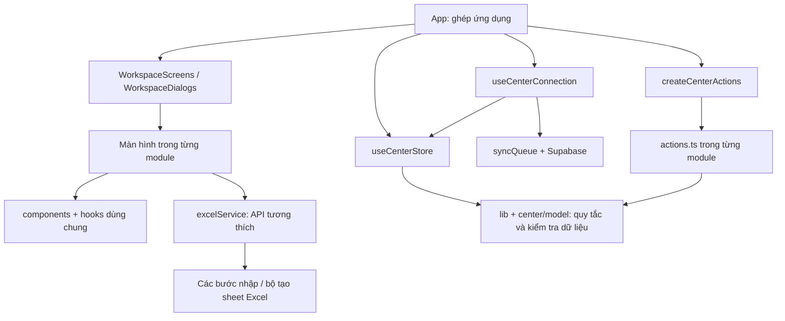

# Cấu trúc module BeeZone

`App.tsx` chỉ ghép giao diện và các bộ điều khiển. Màn hình, thao tác nghiệp vụ, lưu dữ liệu và dịch vụ Excel có trách nhiệm riêng. Việc tách này giúp khoanh vùng thay đổi và kiểm thử; không bảo đảm mọi cập nhật sau này đều không phát sinh lỗi.

## Các phần chính

| Thư mục | Trách nhiệm |
| --- | --- |
| `src/app` | Khung ứng dụng, ghép màn hình/dialog, tìm kiếm nhanh, điều hướng và PWA |
| `src/modules/center` | Trạng thái trung tâm, chuẩn hóa liên kết, đăng nhập/tải dữ liệu và hàng đợi đồng bộ |
| `src/modules/dashboard` | Tổng quan, việc cần làm và bảng chi tiết |
| `src/modules/admissions` | Tuyển sinh và xác nhận ghi danh |
| `src/modules/students` | Hồ sơ học viên, bảo lưu/nghỉ/học lại, lịch sử đăng ký |
| `src/modules/programs`, `classes` | Chương trình, đợt học và sĩ số |
| `src/modules/teachers`, `rooms` | Giáo viên, phân công và phòng học |
| `src/modules/timetable` | Lịch tuần, lịch giáo viên, nghỉ/học bù theo ngày |
| `src/modules/attendance`, `grades` | Điểm danh, điểm số và phiếu kết quả |
| `src/modules/tuition` | Phiếu thu, đóng nhiều đợt, phí theo buổi, công nợ và bản in |
| `src/modules/reports` | Báo cáo quản trị |
| `src/modules/auth` | Giao diện đăng nhập, tài khoản và phân quyền |
| `src/modules/system` | Sao lưu, nhập/xuất, cài đặt, kiểm tra dữ liệu và nhật ký |
| `src/components`, `hooks`, `context` | Thành phần dùng chung: bảng cuộn, dialog, thống kê, bố cục, ngôn ngữ |
| `src/lib` | Quy tắc thuần: ngày, lịch, học phí, buổi học, quyền và kiểm tra payload |
| `src/services/excel` | Đọc ô, từng bước nhập, công thức và từng sheet xuất |
| `api`, `server`, `supabase/migrations` | API có xác thực và quy tắc dữ liệu trên máy chủ |

## Hướng phụ thuộc

Các mũi tên thể hiện phụ thuộc sử dụng; tham chiếu type được TypeScript loại khỏi mã chạy. `actions.ts` khai báo `Context` bằng `Pick<CenterStore, ...>` để chỉ nhận những phần mình cần. Bộ ghép `createCenterActions` kết nối các nhóm thao tác, còn màn hình nhận dữ liệu và callback qua props. Không import màn hình hoặc `App` vào nghiệp vụ.

## Những quy tắc cần giữ khi cập nhật

- `useCenterStore` sở hữu dữ liệu dùng chung và lưu bản xem thử. Không tạo một bản học viên/phiếu thu thứ hai trong module khác. State riêng của form, bộ lọc và dialog có thể nằm trong màn hình.
- Danh sách menu nằm ở `app/navigation.ts`. Sidebar và URL cùng dùng `canAccessTab`; quyền hiển thị không thay thế quyền API/SQL.
- Dữ liệu tải từ Supabase và dữ liệu nhập phải đi qua `parseCenterData` trước khi thay trạng thái. `normalizeCenterData` dùng chung cho tải dữ liệu, nhập Excel và khôi phục JSON. Hàm này sửa liên kết phát sinh và trạng thái phí, không xóa lịch sử giao dịch.
- `applyData` thay toàn bộ bộ dữ liệu đã kiểm tra; dùng thao tác từng module cho thay đổi một hồ sơ. `clearData` chỉ xóa dữ liệu trong bộ nhớ khi kết thúc phiên. Không xóa dữ liệu trình duyệt khi đổi phiên bản schema.
- `student.classId` và `class.teacherId` là tham chiếu gốc. `class.studentIds`, `teacher.assignedClassIds` và `student.feeStatus` được suy ra lại; tránh ghi trạng thái mâu thuẫn.
- Phiếu học phí theo buổi tham chiếu buổi điểm danh và đơn giá chụp tại thời điểm học. Buổi đã lập phiếu phải giữ lịch sử; buổi chưa lập phiếu được tính vào công nợ đọc, không lưu phiếu ảo vào cơ sở dữ liệu.
- Refresh token chỉ cập nhật phiên/quyền, không tải lại dữ liệu đang sửa. Giữ việc trì hoãn truy vấn khỏi callback khóa của Supabase Auth, hủy kết quả phiên cũ, debounce và kiểm tra `updated_at` trước khi lưu. Xung đột phải báo người dùng, không tự ghi đè.
- `services/excelService.ts` là API công khai tương thích. Xuất Excel ghép sheet theo thứ tự để giữ liên kết; `exportContext` chuẩn bị chỉ mục một lần. Nhập xử lý học vụ → học viên → tài chính/điểm danh → điểm/lịch. Không cập nhật state ứng dụng khi một bước nhập còn lỗi.
- Schema, khóa localStorage, URL `?tab=` và định dạng JSON/Excel được giữ tương thích trong lần refactor này. Không có migration hay thay đổi dữ liệu production trong lần tách module.

## Thêm một chức năng

1. Tạo hoặc mở thư mục module phù hợp. Đặt giao diện trong file `.tsx`, quy tắc không phụ thuộc giao diện trong `lib`/model và thao tác thay dữ liệu trong `actions.ts`.
2. Khai báo type và `Context` rõ ràng; tái sử dụng dialog/bảng cuộn/thẻ thống kê dùng chung. Nạp màn hình nặng bằng `lazy` để giữ kích thước khởi động.
3. Nếu thêm trang: khai báo ID/nhãn/icon tại `navigation.ts`, quyền tại `canAccessTab` và case tại `WorkspaceScreens`. Nếu thêm thao tác: ghép trong `createCenterActions` và nối callback của màn hình.
4. Nếu thêm trường dữ liệu: cập nhật type, `parseCenterData`, chuẩn hóa/lưu/tải, sao lưu JSON, Excel khi cần và migration kiểm tra trên máy chủ. Trường cũ thiếu phải có giá trị mặc định hợp lý.
5. Thêm kiểm thử cho quy tắc mới và ảnh hưởng tới các phần liên quan. Chạy `npm run check` trước khi commit. Thử giao diện thực tế nếu thay bố cục; jsdom không đo kích thước màn hình thật.

## Kiểm tra tự động

`npm run check` kiểm tra TypeScript, toàn bộ test và bản production. `tests/architecture.test.ts` chặn vòng phụ thuộc lúc chạy và việc nghiệp vụ/dịch vụ phụ thuộc ngược vào giao diện. `tests/module-actions.test.tsx` kiểm tra kết nối state với nghiệp vụ, lịch sử tài chính, quyền và lưu/khôi phục. Các test đăng nhập, đồng bộ, Excel, database và giao diện tiếp tục kiểm tra hành vi cũ.

GitHub Actions ở `.github/workflows/check.yml` chạy cùng lệnh khi push `main` hoặc mở PR. Có thể đặt job `check` làm điều kiện bắt buộc trong quy tắc nhánh GitHub; lần refactor này không thay đổi quy tắc nhánh của tài khoản.

Một số màn hình nhập liệu vẫn lớn vì chứa nhiều trường và luồng xử lý. Chúng đã nằm trong module riêng; hồ sơ xem chi tiết, bản in phiếu thu, phí buổi và lịch điều chỉnh có component riêng. Khi bổ sung một luồng lớn, tách component/hook theo trách nhiệm và giữ kiểm thử hành vi thay vì chia file chỉ để giảm số dòng.
