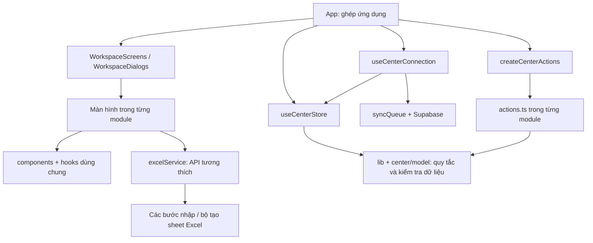

# Cấu trúc module BeeZone

`App.tsx` chỉ ghép giao diện và các bộ điều khiển. Màn hình, thao tác nghiệp vụ, lưu dữ liệu và dịch vụ Excel có trách nhiệm riêng. Việc tách này giúp khoanh vùng thay đổi và kiểm thử; không bảo đảm mọi cập nhật sau này đều không phát sinh lỗi.

## Các phần chính

| Thư mục | Trách nhiệm |
| --- | --- |
| `src/app` | Khung ứng dụng, ghép màn hình/dialog, tìm kiếm nhanh, điều hướng và PWA |
| `src/modules/center` | Trạng thái trung tâm, chuẩn hóa liên kết, đăng nhập/tải dữ liệu và hàng đợi đồng bộ |
| `src/modules/dashboard` | Tổng quan, việc cần làm và bảng chi tiết |
| `src/modules/admissions` | Tuyển sinh và xác nhận ghi danh |
| `src/modules/students` | Hồ sơ học viên, bảo lưu/nghỉ/học lại, lịch sử đăng ký |
| `src/modules/programs`, `classes` | Chương trình, đợt học và sĩ số |
| `src/modules/teachers`, `rooms` | Giáo viên, phân công và phòng học |
| `src/modules/timetable` | Lịch tuần, lịch giáo viên, nghỉ/học bù theo ngày |
| `src/modules/attendance`, `grades` | Điểm danh, điểm số và phiếu kết quả |
| `src/modules/tuition` | Phiếu thu, đóng nhiều đợt, phí theo buổi, công nợ và bản in |
| `src/modules/reports` | Báo cáo quản trị |
| `src/modules/auth` | Giao diện đăng nhập, tài khoản và phân quyền |
| `src/modules/system` | Sao lưu, nhập/xuất, cài đặt, kiểm tra dữ liệu và nhật ký |
| `src/components`, `hooks`, `context` | Thành phần dùng chung: bảng cuộn, dialog, thống kê, bố cục, ngôn ngữ |
| `src/lib` | Quy tắc thuần: ngày, lịch, học phí, buổi học, quyền và kiểm tra payload |
| `src/services/excel` | Đọc ô, từng bước nhập, công thức và từng sheet xuất |
| `api`, `server`, `supabase/migrations` | API có xác thực và quy tắc dữ liệu trên máy chủ |

API quản trị đi qua `server/admin.ts` để dùng chung kiểm tra yêu cầu, xác thực, quyền và quota. `server/request.ts` kiểm tra header/payload, `server/rateLimit.ts` giữ bộ đếm burst có giới hạn bộ nhớ. Quota dùng chung giữa máy chủ và chống ghi dữ liệu trực tiếp nằm trong migration `009_request_quotas.sql`; chỉ triển khai API cần RPC sau khi migration đã được thử và áp dụng. Cấu hình WAF nằm ở Vercel, định nghĩa quy tắc tại `ops/admin-api-rate-limit.json`; chỉ thêm tệp này vào Git không tự bật firewall.

Máy chủ Vite phát triển nạp API qua `server.ssrLoadModule` khi có yêu cầu. Không import handler/helper API trực tiếp vào `vite.config.ts`: các thay đổi API có thể gây nhiều lần khởi động lại và tranh cổng, để HTML trả 200 nhưng JavaScript trả 504. Khi kiểm tra localhost, kiểm tra cả `/@vite/client`, module JavaScript và API ngoài HTML. Production tiếp tục chạy handler Vercel riêng.

## Hướng phụ thuộc

Các mũi tên thể hiện phụ thuộc sử dụng; tham chiếu type được TypeScript loại khỏi mã chạy. `actions.ts` khai báo `Context` bằng `Pick<CenterStore, ...>` để chỉ nhận những phần mình cần. Bộ ghép `createCenterActions` kết nối các nhóm thao tác, còn màn hình nhận dữ liệu và callback qua props. Không import màn hình hoặc `App` vào nghiệp vụ.

## Những quy tắc cần giữ khi cập nhật

- `useCenterStore` sở hữu dữ liệu dùng chung và lưu bản xem thử. Không tạo một bản học viên/phiếu thu thứ hai trong module khác. State riêng của form, bộ lọc và dialog có thể nằm trong màn hình.
- Danh sách menu nằm ở `app/navigation.ts`. Sidebar và URL cùng dùng `canAccessTab`; quyền hiển thị không thay thế quyền API/SQL.
- Bộ lọc có tên chương trình/lớp dài dùng `components/ResponsiveSelect.tsx`. Component nhận giá trị và callback từ module, không giữ bản dữ liệu nghiệp vụ riêng. Dropdown dùng Radix Select để quản lý focus, bàn phím và vị trí; CSS giới hạn chiều rộng/chiều cao theo viewport, cho tên lựa chọn xuống dòng. Khi thêm bộ chọn tương tự, tái sử dụng component và kiểm tra cả trạng thái mở.
- Dữ liệu tải từ Supabase và dữ liệu nhập phải đi qua `parseCenterData` trước khi thay trạng thái. `normalizeCenterData` dùng chung cho tải dữ liệu, nhập Excel và khôi phục JSON. Hàm này sửa liên kết phát sinh và trạng thái phí, không xóa lịch sử giao dịch.
- `applyData` thay toàn bộ bộ dữ liệu đã kiểm tra; dùng thao tác từng module cho thay đổi một hồ sơ. `clearData` chỉ xóa dữ liệu trong bộ nhớ khi kết thúc phiên. Không xóa dữ liệu trình duyệt khi đổi phiên bản schema.
- `student.classId` và `class.teacherId` là tham chiếu gốc. `class.studentIds`, `teacher.assignedClassIds` và `student.feeStatus` được suy ra lại; tránh ghi trạng thái mâu thuẫn.
- Phiếu học phí theo buổi tham chiếu buổi điểm danh và đơn giá chụp tại thời điểm học. Buổi đã lập phiếu phải giữ lịch sử; buổi chưa lập phiếu được tính vào công nợ đọc, không lưu phiếu ảo vào cơ sở dữ liệu.
- Refresh token chỉ cập nhật phiên/quyền, không tải lại dữ liệu đang sửa. Giữ việc trì hoãn truy vấn khỏi callback khóa của Supabase Auth, hủy kết quả phiên cũ, debounce và kiểm tra `updated_at` trước khi lưu. Xung đột phải báo người dùng, không tự ghi đè.
- `services/excelService.ts` là API công khai tương thích. Xuất Excel ghép sheet theo thứ tự để giữ liên kết; `exportContext` chuẩn bị chỉ mục một lần. Nhập xử lý học vụ → học viên → tài chính/điểm danh → điểm/lịch. Không cập nhật state ứng dụng khi một bước nhập còn lỗi.
- Schema, khóa localStorage, URL `?tab=` và định dạng JSON/Excel được giữ tương thích trong lần refactor này. Không có migration hay thay đổi dữ liệu production trong lần tách module.

## Thêm một chức năng

1. Tạo hoặc mở thư mục module phù hợp. Đặt giao diện trong file `.tsx`, quy tắc không phụ thuộc giao diện trong `lib`/model và thao tác thay dữ liệu trong `actions.ts`.
2. Khai báo type và `Context` rõ ràng; tái sử dụng dialog/bảng cuộn/thẻ thống kê dùng chung. Nạp màn hình nặng bằng `lazy` để giữ kích thước khởi động.
3. Nếu thêm trang: khai báo ID/nhãn/icon tại `navigation.ts`, quyền tại `canAccessTab` và case tại `WorkspaceScreens`. Nếu thêm thao tác: ghép trong `createCenterActions` và nối callback của màn hình.
4. Nếu thêm trường dữ liệu: cập nhật type, `parseCenterData`, chuẩn hóa/lưu/tải, sao lưu JSON, Excel khi cần và migration kiểm tra trên máy chủ. Trường cũ thiếu phải có giá trị mặc định hợp lý.
5. Thêm kiểm thử cho quy tắc mới và ảnh hưởng tới các phần liên quan. Chạy `npm run check` trước khi commit. Thử giao diện thực tế nếu thay bố cục; jsdom không đo kích thước màn hình thật.

## Kiểm tra tự động

`npm run check` kiểm tra TypeScript, toàn bộ test và bản production. `tests/architecture.test.ts` quét `src`, `api`, `server` theo cách TypeScript giải quyết đường dẫn trong `tsconfig.json`. Bộ kiểm tra theo cả import tương đối, alias, re-export, lazy import và `require` có tên module dạng literal; bỏ qua tham chiếu chỉ dùng cho type. Nó chặn vòng phụ thuộc và phụ thuộc ngược từ nghiệp vụ/dịch vụ vào giao diện, kể cả qua helper trung gian hoặc import React trong tệp `.ts`.

Kiểm tra ranh giới máy chủ chặn API/server dùng workflow ghi state, UI hoặc Supabase client lưu phiên trình duyệt. Mã trình duyệt không được import handler `api`/`server` hoặc module dùng tiền tố `node:`. Đặt quy tắc có thể dùng ở hai phía trong `lib`/model; API vẫn phải tự xác thực và kiểm tra quyền. Các import có đường dẫn tính toán hoặc mã sinh tự động cần được rà riêng.

`tests/module-actions.test.tsx` kiểm tra kết nối state với nghiệp vụ, lịch sử tài chính, quyền và lưu/khôi phục. Các test đăng nhập, đồng bộ, Excel, database và giao diện tiếp tục kiểm tra hành vi cũ. Các ca giả lập phụ thuộc sai trong test kiến trúc chứng minh bộ kiểm tra phát hiện được lỗi, thay vì chỉ kiểm tra dự án hiện tại đang qua.

GitHub Actions ở `.github/workflows/check.yml` chạy cùng lệnh khi push `main` hoặc mở PR. Có thể đặt job `check` làm điều kiện bắt buộc trong quy tắc nhánh GitHub; lần refactor này không thay đổi quy tắc nhánh của tài khoản.

Một số màn hình nhập liệu vẫn lớn vì chứa nhiều trường và luồng xử lý. Chúng đã nằm trong module riêng; hồ sơ xem chi tiết, bản in phiếu thu, phí buổi và lịch điều chỉnh có component riêng. Khi bổ sung một luồng lớn, tách component/hook theo trách nhiệm và giữ kiểm thử hành vi thay vì chia file chỉ để giảm số dòng.

Thông báo vắng cho phụ huynh nằm trong `modules/attendance/ParentContactDialog.tsx`; mẫu tin, số điện thoại và quy tắc giữ lịch sử nằm trong `parentContact.ts`, thao tác ghi nhận ở `actions.ts`. Nhân viên lưu điểm danh trước khi soạn tin/gọi và tự xác nhận đã liên hệ; sao chép hoặc mở cuộc gọi không đánh dấu đã gửi. Lần liên hệ được lưu thành dòng có thời gian theo giờ Việt Nam, kênh và người ghi nhận trong `AttendanceStudentEntry.note`, tương thích JSON/Excel cũ và dùng quyền sửa điểm danh theo lớp trên SQL hiện có. Đây là ghi nhận thủ công, không phải xác nhận giao tin của Zalo. Sửa nhận xét, đổi trạng thái điểm danh và lưu lại phải giữ các dòng lịch sử này; không thêm trường schema hay migration cho luồng này.

## Chọn nơi sửa và kiểm tra phần liên quan

Privacy của tài khoản nằm trong profile máy chủ (`is_private`, migration 010), không lấy từ metadata người dùng, email hardcode hay localStorage. `profileToAccount` chỉ ánh xạ cờ này sang hiển thị; nó không đổi quyền. API tài khoản vẫn qua `adminApi`/quota và bỏ danh tính tài khoản riêng khỏi danh sách, trả các ID chỉ để lọc phiên cục bộ đã lưu trước đây. Profile cũ thiếu cờ mặc định hiển thị như cũ. Script `create-private-owner-setup.mjs` chỉ sinh SQL riêng vào `.vercel` từ stdin; không commit email hoặc tự chạy SQL production. Ghi nhận quyền qua allowlist có audit; không xóa lịch sử để ẩn tài khoản.

Nhật ký production dùng bản hiển thị do `/api/admin/audit-logs` tạo từ profile máy chủ qua `lib/auditPrivacy.ts`: bỏ các dòng cấp quyền nhắm vào tài khoản riêng, thay danh tính người thực hiện riêng bằng tên hệ thống và loại email khỏi nội dung trả về. `useAccountAudit` chỉ hiển thị bản này, chặn kết quả phiên cũ và không dùng nhật ký thô làm dự phòng khi API lỗi. Nhật ký gốc trong database, state đồng bộ và sao lưu vẫn được giữ nguyên; bản hiển thị không được ghi ngược vào dữ liệu trung tâm. Nút Làm mới tải lại nhật ký đã lưu trên máy chủ.

Địa chỉ chính là `https://beezone-english.vercel.app`. Hai alias theo team được chuyển hướng ở trang gốc bằng `vercel.json`; callback có mã OAuth được ứng dụng xử lý riêng qua `lib/appUrl.ts` trước khi tạo Supabase client. Mã PKCE/phiên trình duyệt thuộc một origin, nên callback cũ trên alias được bỏ mã rồi chuyển sang trang đăng nhập của domain chính, không chuyển token hoặc verifier giữa các domain. Localhost và deployment xem thử không bị chuyển hướng. Sau khi SDK trả về phiên hợp lệ, dọn tham số OAuth còn sót mà giữ `?tab=`, tham số giao diện và anchor thường.

| Thay đổi | Nơi sửa chính | Phần liên quan cần kiểm tra |
| --- | --- | --- |
| Tiếp nhận, ghi danh, chuyển lớp, bảo lưu | `modules/admissions`, `modules/students/actions.ts`, `lib/operations` | Roster lớp, lịch sử đăng ký, điểm/phiếu thu lớp cũ; `module-actions`, `operations`, `data` |
| Lớp, giáo viên, phòng và lịch | Các module tương ứng, `lib/schedule`, `lib/operations`, `center/model` | Trùng giáo viên/phòng/giờ, phân công, sĩ số, lịch nghỉ/học bù; `operations`, `module-actions`, `database` |
| Thu tiền và phí theo buổi | `modules/tuition`, `modules/attendance`, `lib/tuition`, `lib/sessionBilling` | Có mặt/đi trễ, buổi vắng, đơn giá đã chốt, thu nhiều đợt, công nợ, báo cáo/Excel; các test `session-billing`, `excel`, `module-actions` |
| Điểm số | `modules/grades`, validation payload, sheet/nhập điểm Excel | Điểm theo học viên–lớp, lịch sử khi chuyển lớp, quyền nhập điểm; `ui`, `excel`, `database`, `module-actions` |
| Trường dữ liệu hoặc định dạng nhập/sao lưu | `types`, `lib/centerData`, `center/model`, `services/excel`, schema máy chủ | Mặc định cho dữ liệu cũ, validation trước khi thay state, giữ lịch sử; `data`, `excel`, `database`, `module-actions` |
| Đăng nhập, phân quyền, đồng bộ | `modules/center/useCenterConnection`, `lib/auth`, `lib/syncQueue`, API/SQL | Refresh không nạp đè bản đang sửa, CAS, phiên cũ, quyền máy chủ; `auth`, `sync`, `database`, `production` |
| Giao diện hoặc mục menu mới | Module UI, `components`/`hooks`, `app/navigation`, `WorkspaceScreens` | Quyền menu/URL, responsive, popup mở và dialog, chuột/cảm ứng/bàn phím; `navigation`, `responsive`, các test UI liên quan |

Tên trong cột cuối là nhóm test để tìm nhanh trong `tests`; trước commit vẫn chạy toàn bộ `npm run check`. Với thay đổi UI, thử cả tên dữ liệu dài, danh sách chọn đang mở, modal và bàn phím ảo trên viewport hẹp. Test jsdom không xác nhận được bố cục pixel của trình duyệt thật.
