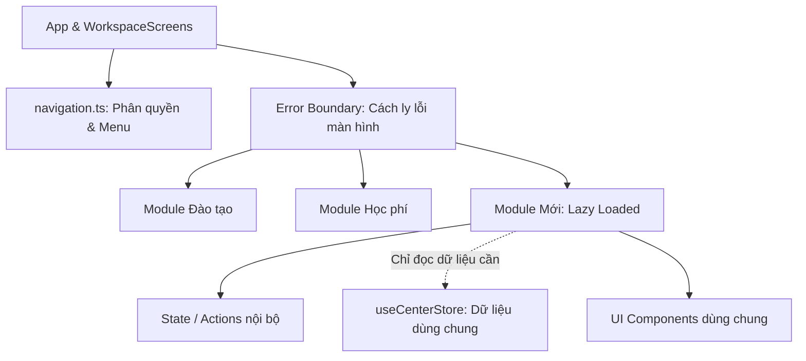

# Hướng Dẫn Cấu Hình & Phát Triển Module Mới (BeeZone Plug-and-Play Guide)

Tài liệu này chuẩn hóa quy trình cấu hình và tích hợp module mới vào hệ thống BeeZone. Mục tiêu cốt lõi: **đưa tính năng mới vào đơn giản, cách ly dữ liệu độc lập, không làm ảnh hưởng đến các danh mục bộ phận khác và triệt tiêu rủi ro phát sinh lỗi (Zero Regression).**

---

## 1. Mô Hình Kiến Trúc Module Độc Lập

Hệ thống BeeZone hoạt động theo mô hình **Plug-and-Play (Cắm - Ghép)**:
- Gốc ứng dụng (`App.tsx`, `WorkspaceScreens.tsx`, `navigation.ts`) đóng vai trò khung gắn kết và điều phối điều hướng.
- Mỗi module nghiệp vụ nằm trong thư mục riêng biệt tại `src/modules/<tên_module>/`.
- Các module **không phụ thuộc trực tiếp lẫn nhau**; giao tiếp thông qua State trung tâm (`useCenterStore`) và quy tắc thuần (`src/lib`).



---

## 2. Quy Trình 4 Bước Tích Hợp Module Mới

Khi cần bổ sung một nghiệp vụ hoặc phòng ban mới (ví dụ: `asset` - Quản lý trang thiết bị, `evaluation` - Đánh giá học viên, `dormitory` - Ký túc xá...):

### Bước 1: Khởi tạo thư mục Module
Tạo thư mục `src/modules/<tên_module>/` với cấu trúc chuẩn:
```text
src/modules/<tên_module>/
├── <TenModule>View.tsx    # Giao diện chính của màn hình
├── actions.ts             # Thao tác nghiệp vụ thuần (không chứa mã React UI)
├── types.ts               # Định nghĩa kiểu dữ liệu nội bộ của module
└── components/            # Các form, modal, bảng con dùng riêng trong module
```

### Bước 2: Đăng ký Menu & Phân quyền (`src/app/navigation.ts`)
1. Thêm mục vào nhóm danh mục bộ phận phù hợp trong `NAVIGATION_GROUPS`:
```typescript
{
  id: 'my-feature',
  label: 'Tên tính năng mới',
  icon: Sparkles,
  iconColor: 'text-amber-600',
}
```
2. Cấu hình quyền truy cập trong hàm `canAccessTab`:
```typescript
case 'my-feature':
  // Chỉ cho phép đúng bộ phận truy cập (ví dụ: Chủ trung tâm hoặc nhân viên có quyền cụ thể)
  return user.role === 'owner' || permissions.academic.classes;
```

### Bước 3: Đăng ký nạp lười (Lazy Load) tại `src/app/WorkspaceScreens.tsx`
Khai báo nạp bất đồng bộ để không làm tăng kích thước bundle khởi động của các module khác:
```typescript
const MyFeatureView = lazy(() =>
  import('../modules/my-feature/MyFeatureView').then((m) => ({ default: m.MyFeatureView })),
);
```
Ghép màn hình vào khối switch-case:
```typescript
case 'my-feature':
  return (
    <Suspense fallback={<ScreenLoadingFallback />}>
      <MyFeatureView currentUser={currentUser} />
    </Suspense>
  );
```

### Bước 4: Viết kiểm thử tự động & Chạy kiểm tra
Tạo tệp kiểm thử `tests/my-feature.test.tsx` kiểm tra:
1. Người dùng đúng quyền mở được màn hình.
2. Người dùng không có quyền bị chặn điều hướng.
3. Chạy lệnh:
```bash
npm run check
```
Hệ thống sẽ tự động quét TypeScript, Vitest và Architecture Guard. Khi cả 3 bước đều xanh (Exit code 0), module đã sẵn sàng hoạt động an toàn trên Production.

---

## 3. Các Nguyên Tắc Cách Ly Tránh Lỗi Giữa Các Bộ Phận

1. **Ranh giới Dữ liệu (State Isolation):**
   - Không lưu dữ liệu trùng lặp (không tạo danh sách học viên hay lớp học thứ hai). Dùng `useCenterStore` cho dữ liệu chung.
   - Thao tác nghiệp vụ trong `actions.ts` chỉ nhận những phần store mình cần thông qua `Pick<CenterStore, 'students' | 'classes'>`.
   - Dữ liệu nghiệp vụ riêng của module thì tự quản lý bằng storage nội bộ hoặc bảng Supabase riêng (như cách `BeeZoneWork` hoạt động).

2. **Ranh giới UI (Fault Tolerance):**
   - Mỗi màn hình module được bọc bởi `Suspense` và cơ chế phòng vệ lỗi. Nếu một module mới phát sinh ngoại lệ không mong muốn, lỗi được khoanh vùng tại chỗ, **các màn hình Điểm danh, Thu tiền, Học viên của các bộ phận khác vẫn hoạt động bình thường 100%**.

3. **Không import chéo giữa các Module:**
   - Tuyệt đối không import component giao diện của Module A vào Module B.
   - Nếu có component hoặc hàm tính toán dùng chung, chuyển vào `src/components/` hoặc `src/lib/`.

4. **Bảo vệ Kiến trúc Tự động (`tests/architecture.test.ts`):**
   - Hệ thống tích hợp sẵn bộ kiểm tra kiến trúc tự động:
     - Chặn vòng lặp phụ thuộc (`runtime cycles`).
     - Chặn các file logic thuần (`.ts`) import thư viện React (`.tsx`).
     - Chặn mã trình duyệt import API máy chủ và ngược lại.

